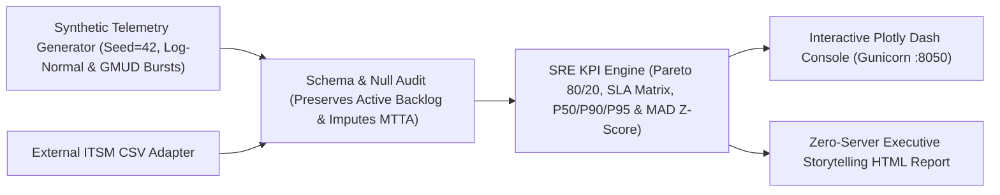

# SRE & Tier-3 Sustainment Incident Intelligence Engine (`Python` · `Pandas` · `Plotly` · `Dash`)

[](https://github.com/evslopes/sre-incident-analytics-dash/actions/workflows/ci.yml)


> 🇺🇸 **EN:** Clean-room **SRE & Tier-3 Sustainment Incident Intelligence Engine** built with **Python**, **Pandas**, **NumPy**, **Plotly**, and **Dash**. Combines **Pareto `80/20` chronic failure fingerprinting**, **contractual SLA compliance heatmaps**, **right-skewed `MTTR` percentiles (`P50`/`P90`/`P95`)**, **robust `MAD` (*Median Absolute Deviation*) anomaly detection**, **GMUD change-failure correlation**, an **interactive Dash console**, and a **zero-server Executive Data-Storytelling HTML exporter** — powered 100% by deterministic synthetic telemetry (`Zero NDA / Zero PII`).  
> 🇧🇷 **PT:** Motor analítico **clean-room de Engenharia de Sustentação Nível 3 (L3), SRE e Data Storytelling** em **Python**, **Pandas**, **NumPy**, **Plotly** e **Dash**. Une **identificação de recorrência crônica de Pareto (`80/20`)**, **matrizes de conformidade de SLA contratual**, **percentis de `MTTR` (`P50`/`P90`/`P95`)**, **detecção estatística robusta de anomalias via `MAD`**, **correlação com janelas de mudança (`GMUD`)**, **console interativo Dash** e **exportador executivo HTML autônomo** — operando sobre massa **100% sintética e determinística (`Zero NDA / Zero PII`)**.

---

## Arquitetura & Pipeline Analítico



### Pilares de Engenharia Operacional & Estatística

| Dimensão Técnica | Armadilha Comum em Dashboards de Suporte | Abordagem Adotada neste Motor |
| :--- | :--- | :--- |
| **Governança de Dados (`Zero NDA`)** | Expor dumps reais de tickets corporativos ou descartar chamados em aberto silenciosamente | Gerador sintético reproduzível (`synthetic_generator.py`) + auditoria explícita (`DataQualityAudit`) que preserva o *backlog* ativo sem *data leakage* ([ADR-0001](docs/adr/0001-zero-nda-synthetic-telemetry-governance.md)) |
| **Assimetria de `MTTR` & Outliers** | Usar média aritmética simples e Z-Score gaussiano ($\mu \pm 3\sigma$), mascarando picos reais | Percentis `P50` / `P90` / `P95` em escala logarítmica e **Modified Z-Score via `MAD` ($M_i > 3.5$)** imune a explosões pós-deploy ([ADR-0002](docs/adr/0002-robust-mad-anomaly-detection-and-skewed-mttr-percentiles.md)) |
| **Eliminação de Toil (`Pareto 80/20` & Six Sigma)** | Tratar incidentes isoladamente sem agrupar assinaturas sistêmicas | *Fingerprinting* automático `service :: root_cause_category` destacando os *Vital Few* que concentram `80%` do esforço N2/N3 |
| **Correlação de Mudanças (`GMUD`)** | Avaliar taxa de reabertura global sem isolar janelas de release | Comparação direta de *Reopen Rate* e picos de volume entre incidentes correlacionados a GMUD vs operação basal |
| **Dupla Superfície de Consumo** | Duplicar regras de cálculo entre painel operacional e apresentação gerencial | Núcleo puro compartilhado entre o **Console Reativo Dash** e o **Exportador Executivo HTML Autônomo** ([ADR-0003](docs/adr/0003-dual-surface-observability-dash-and-executive-html.md)) |

---

## Execução Rápida (`venv` + CLI `sre-analytics`)

```bash
# 1. Criar ambiente virtual isolado e instalar pacote + suíte de testes
python -m venv .venv
source .venv/bin/activate        # Windows PowerShell: .\.venv\Scripts\Activate.ps1
pip install -e ".[dev]"

# 2. Executar suíte automatizada Pytest
pytest -v

# 3. Gerar massa sintética determinística (2.400 incidentes em 6 serviços)
sre-analytics generate-data --rows 2400 --seed 42 --output data/synthetic_incidents.csv

# 4. Exportar Relatório Executivo HTML autocontido (Data Storytelling + DMAIC)
sre-analytics export-report --input data/synthetic_incidents.csv --output reports/executive_sre_report.html

# 5. Inspecionar sumário JSON de KPIs, auditoria de higiene e recomendações L3
sre-analytics summary --input data/synthetic_incidents.csv

# 6. Iniciar Console Interativo Plotly Dash em http://127.0.0.1:8050
sre-analytics serve --input data/synthetic_incidents.csv --port 8050
```

### Execução Containerizada (`Docker` + `Gunicorn`)

```bash
docker build -t sre-incident-analytics-dash .
docker run --rm -p 8050:8050 sre-incident-analytics-dash
```

---

## Estrutura Modular do Projeto

```text
sre-incident-analytics-dash/
├── .github/workflows/ci.yml      # Matriz Python 3.11 & 3.12 (Pytest + CLI Smoke + Docker Build)
├── docs/adr/                     # Architecture Decision Records (Zero-NDA, MAD Z-Score, Dual Surface)
├── src/sre_analytics/
│   ├── schema.py                 # Contratos SLA, auditoria explícita de NULLs e prevenção de leakage
│   ├── synthetic_generator.py    # Gerador determinístico (Pareto, Log-Normal MTTR e bursts GMUD)
│   ├── kpi_engine.py             # Motor Pareto 80/20, Matriz SLA, Percentis, MAD e recomendações RCA
│   ├── figures.py                # Construtor de gráficos Plotly dark-mode reutilizáveis
│   ├── report_exporter.py        # Gerador de relatório HTML executivo autocontido
│   ├── app.py                    # Console interativo Plotly Dash com filtros reativos
│   └── cli.py                    # Interface de linha de comando (`sre-analytics`)
├── tests/                        # Suíte Pytest cobrindo higiene de schema, matemática KPI e callbacks Dash
├── Dockerfile                    # Imagem slim não-root servida via Gunicorn (workers + threads)
└── pyproject.toml
```

---

## Autor & Licenciamento

Projetado e desenvolvido por **Elvis Freitas Lopes Herllain** — Senior Software Engineer, Tech Lead & Solutions Architect ([jhhsolutions.dev](https://jhhsolutions.dev) · [LinkedIn](https://www.linkedin.com/in/evslopes/) · [X / @evslopes](https://x.com/evslopes)).

Distribuído sob a licença [MIT](LICENSE).
